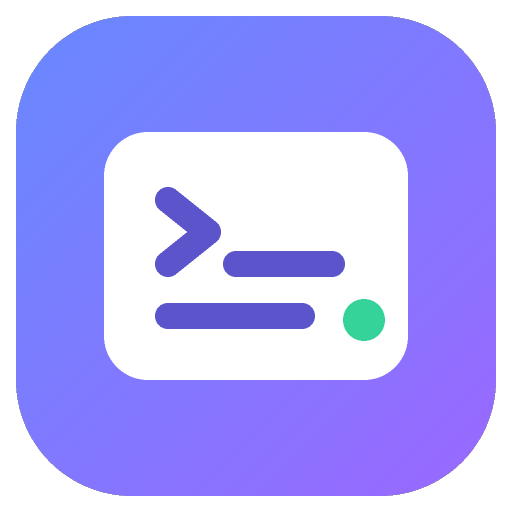
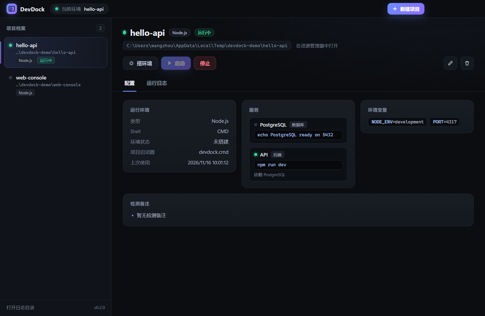

<div align="center">
  
  <h1>DevDock</h1>
  <p><strong>Windows 本地项目启动器</strong><br />录入一次路径与命令，之后一键搭环境、一键启动；支持前端 / 后端 / 数据库多服务编排，切换项目自动清理旧环境。</p>
  <p>
    
    
    
  </p>
</div>

---

<div align="center">
  
</div>

## 它解决什么问题

你有十几个本地仓库。每次开工都要回忆：这个项目用 pnpm 还是 npm？先跑 migrate 还是先起 docker？`.env` 要填哪几个变量？开三个终端窗口切来切去，关掉之后进程还赖在后台。

DevDock 把这些知识变成**项目档案**：

- 选一次目录，自动识别项目类型和常用命令
- 点「搭环境」执行安装，点「启动」跑起来，日志实时滚动
- 同一时间只有一个**活跃环境**，切到下一个项目时自动停掉旧进程、还原被改写的 `.env`
- 关掉应用再打开，上次的项目和环境状态还在

## 功能

| | |
| --- | --- |
| **项目档案** | 名称、路径、Shell、环境变量、服务列表，全部本地持久化 |
| **多服务编排** | 一个项目可含前端 / 后端 / 数据库 / 后台任务，按依赖顺序启动 |
| **数据库等待** | 为数据库服务填端口，启动后轮询 TCP 直到就绪，超时自动回滚已起的服务 |
| **自动检测** | Node（npm/pnpm/yarn/bun）、Python（pip/poetry/uv/pipenv）、Rust、Go、.NET、Docker Compose、Ruby、Java、PHP |
| **README 优先识别** | 先从 README 代码块提取安装 / 启动命令与端口，识别不到再退回目录结构推断，并在界面标注来源 |
| **项目结构识别** | 自动解析 `docker-compose.yml` 多服务、`pnpm-workspace.yaml` / `workspaces` 子包，生成对应服务 |
| **项目内启动器** | 保存时在项目目录生成 `devdock.cmd` + `.devdock/project.json`，双击即自动拉起整套服务 |
| **一键搭环境** | 按依赖顺序执行各服务的安装命令，输出实时推送并落盘 |
| **环境体检** | 同时读 README 与 `package.json` / `requirements.txt` / `pyproject.toml`，逐项判断已就绪（绿）/ 缺失（黄）/ 异常（红） |
| **按需安装** | 缺什么装什么；需要下载或升级工具时先弹确认框，同意后才联网执行 |
| **装完复检** | 安装结束自动重新体检，仍缺什么会明确列出来，不会假装成功 |
| **多布局兼容** | Python 的 `.venv\Scripts` 与 MSYS2/Cygwin 的 `.venv/bin` 都识别；`Procfile` / `.python-version` / `requirements/` 子目录 / `setup.py` 都能用 |
| **子项目识别** | 根目录没有清单时，自动识别一层 `backend/` + `web/` 这类前后端子项目并分别装环境、分别启动 |
| **venv 命令切换** | 检测到 venv 后，启动与安装里的 `python` / `pip` / `uvicorn` 自动改用 venv 解释器，不会装到系统 Python |
| **数据库口令** | 识别 PostgreSQL / MySQL / Redis / MongoDB，弹窗输入口令后自启本机数据库服务并注入连接串 |
| **删除即清理** | 删除档案时询问是否连同 `.venv` / `node_modules` / `.devdock` 等环境残留一起删除 |
| **启动失败诊断** | 进程退出后按日志归类（权限 / 端口占用 / 缺命令 / 缺依赖 / 数据库连不上 / 秒退），能修的给一键修复，权限问题直接弹窗提权 |
| **一键启动/停止** | 通过 `taskkill /T /F` 结束整棵进程树，不留孤儿进程 |
| **环境隔离** | 子进程级注入环境变量；可选把变量写进项目 `.env`，停止或切换时自动还原 |
| **活跃环境唯一** | 切换项目时停旧进程、还原旧 `.env`、写切换记录 |
| **分区日志** | 按服务筛选日志、按 `项目/服务` 分目录保存、一键定位日志文件；stderr 按内容分级，正常进度不标红 |

## 快速开始

### 方式一：下载安装包

到 [Releases](../../releases) 下载最新的 `DevDock-Setup-x.y.z.exe`（安装版）或 `DevDock-x.y.z.exe`（免安装版）。

> Windows 可能会对未签名程序弹出 SmartScreen 提示，点「更多信息 → 仍要运行」即可。

### 方式二：从源码运行

```powershell
git clone https://github.com/WRTwang/devdock.git
cd devdock
npm install
npm start
```

需要 Node.js 20+（开发时使用 Node 24）。

## 使用

1. 点右上角 **新建项目**，选择项目目录。
2. DevDock 会自动识别项目类型；如果是 docker-compose 或 workspace 项目，会直接生成多个服务。
3. 在「服务」区域检查每个服务的角色、目录、命令、端口和依赖，不对就改。
4. 需要的话展开**环境变量**，按 `KEY` / `value` 逐行添加。
5. 保存后该项目自动成为**当前环境**。
6. 点 **环境体检** 看缺什么：绿色=已就绪，黄色=缺失，红色=命令失败；点「安装缺失项」逐项确认后安装。
7. 点 **搭环境** 按依赖顺序安装各服务依赖（首次启动时若开启自动搭建也会先跑一次）。
8. 点 **启动**：数据库先起并等到端口就绪，再起后端，最后起前端；切到「运行日志」可按服务筛选。
9. 点 **停止** 结束整棵进程树。

### 多服务项目怎么配

一个服务 = 一套「目录 + 安装命令 + 启动命令 + 端口 + 依赖」。

| 角色 | 例子 | 典型配置 |
| --- | --- | --- |
| 数据库 | PostgreSQL / MySQL / Redis | 启动命令 `docker compose up -d db`，端口 `5432` |
| 后端 | NestJS / Spring Boot / FastAPI | 目录 `server`，端口 `4000`，依赖数据库 |
| 前端 | Vite / Next.js | 目录 `web`，端口 `5173`，依赖后端 |
| 后台任务 | 队列消费者 / 定时任务 | 目录 `worker`，依赖数据库 |

- **依赖**决定启动顺序；成环会拒绝启动并提示环上的服务。
- **端口**只对数据库服务做就绪等待：DevDock 会轮询 TCP，超时（默认 60s）则回滚本次已启动的服务。
- 没有启动命令的服务会被跳过，但如果配了端口仍会等待。
- 同一个项目里，每个服务最多一个运行实例。

### 自动识别命令

保存项目时 DevDock 会做两轮识别，优先级从高到低：

1. **README.md 代码块**：提取 `npm install` / `pnpm dev` / `uvicorn ... --port 8000` 这类命令和端口。
2. **目录结构**：`package.json`、`requirements.txt`、`Cargo.toml`、`docker-compose.yml`、workspace 配置等。

识别结果会在弹窗里标注来源（例如「启动命令来自 README.md」）。识别错了直接在服务里改，保存后以你的版本为准。多服务项目里，README 的整体命令不会强行套到每个服务，只作为提示。

### 环境体检与按需安装

「环境体检」页把 README 里的安装说明和项目清单合成一张表，只读探测本机，不会偷偷装东西：

| 颜色 | 含义 | 例子 |
| --- | --- | --- |
| 绿 | 已经就绪 | `node_modules` 存在；`.venv` 里的依赖齐全；Docker 可用 |
| 黄 | 缺少环境 | 没装 `node_modules`、没建 `.venv`、缺依赖、本机数据库服务未启动 |
| 红 | 命令执行失败 | 虚拟环境在但 `pip list` 报错、工具版本探测失败 |

- **同时读 README 与清单**：README 写了安装步骤时，会按语言并回对应的体检项（并优先使用 README 的命令）；只有完全对不上生态的命令才单独列一条「README 安装步骤」。
- **README 命令不装错地方**：README 里的裸 `pip install` 会自动改写成项目 venv 里的解释器；README 指向尚未创建的 venv 时会先建环境。
- **venv 布局兼容**：优先用 Windows 的 `py -3` 创建原生 `.venv\Scripts`；如果只有 MSYS2 / Cygwin 的 Python，也能识别 `.venv\bin` 并在两种布局间自动回退。
- **启动自动切 venv**：项目里有 venv 时，`python app.py`、`pip install`、`uvicorn ...` 会自动换成 venv 解释器，不会出现「装好了但启动找不到包」。
- **`.env` 准备**：只有 `.env.example` / `.env.sample` 时，会提示并复制一份 `.env`；删除项目时只有「原样未改」的副本才会被清掉。
- **清单兜底**：`setup.py`、`requirements/base.txt`、`.python-version`、`Procfile` / `Procfile.windows` 都能识别；`%PORT%` 会替换成具体端口。
- **子项目**：根目录没有清单时，会扫一层子目录，识别 `backend/`（Python）与 `web/`（Node）这类结构，分别安装、分别启动。
- **优先用你已有的工具**：Python 项目按 `uv.lock` → `pyproject.toml` 的 Poetry → `Pipfile` → 默认 `python -m venv` 依次选择；工具已装且版本达标就直接用，不再重复安装。
- **需要下载才弹窗**：工具缺失或版本低于最低要求时，安装计划里标记「需下载」，只有点「同意并安装」才执行 `winget` / `npm -g` / `pip install -U`。
- **逐项安装**：每条缺失项右侧都有「安装此项」，也可以点右上角「安装缺失项」一次装完。
- 安装命令都在项目目录执行，日志进入「运行日志」的 `env` 服务分区。

### 数据库口令与自启

项目里出现 `postgres` / `mysql` / `redis` / `mongo` 的 compose 镜像、数据库服务或 README 说明时，DevDock 会识别引擎与端口：

1. 点「环境体检」页的 **输入密码并启动**（或直接点「启动」，会先弹这个框）。
2. 填用户名 / 数据库名 / 密码，口令只留在内存，`profiles.json` 里不保存。
3. 本机装了对应 Windows 服务且没有运行，会执行 `net start <服务名>`；容器数据库则交给 docker compose。
4. 连接串按引擎拼成 `DATABASE_URL`（Redis 为 `REDIS_URL`），启动服务时注入；勾选写入 `.env` 时会同步落盘，停止或切换时自动还原。
5. 下次启动若内存里没有口令，会再次弹框——这是刻意的，避免明文落盘。

删除项目时会把残留列清楚，默认全选：

- **环境与 DevDock 残留**：项目内任意层级的 `.venv` / `venv` / `node_modules` / `.devdock` / `devdock.cmd`；原样未改的 `.env` 副本也会清掉。
- **缓存与构建产物**：`__pycache__`、`.pytest_cache`、`.mypy_cache`、`.next`、`dist`、`build`、`target`、`coverage` 等，可在弹窗里取消勾选。
- **Docker**：检测到 `docker compose` 时，删除前会执行 `docker compose down --remove-orphans` 停掉该项目的容器（保留数据卷）。

项目源码永远不会被删除。实测：Node 项目删除后 `node_modules`、`.devdock`、`devdock.cmd`、复制出来的 `.env` 全部消失；Python 项目同样清掉 `.venv`。

### 启动失败时

进程启动后如果很快退出，DevDock 会把最近的日志归类成一个明确的问题弹出来，而不是只留一句 `进程退出 (code=0)`：

| 问题 | 处理 |
| --- | --- |
| 拒绝访问 / `0x5` / `EACCES` | 弹窗提供「以管理员身份重启 DevDock」，允许后自动重启 |
| 端口被占用（`EADDRINUSE`） | 「自动修复并重试」会结束占用该端口的进程，再重新启动项目 |
| 找不到命令 | 提示去「环境体检」安装对应运行时 |
| 模块缺失 / `Missing script` | 提示补依赖或改 `package.json` 里的脚本 |
| 连不上数据库（`ECONNREFUSED 5432` 等） | 提示回「环境体检」启动数据库并填写口令 |
| 启动后立刻退出（`code=0`） | 提示命令是否常驻；若是 DevDock 自己会直接拦截 |

另外，**把 DevDock 自己的目录当项目启动会被直接拦下**：再开一个实例只会被单实例锁结束，并伴随 `0x5` 缓存报错。弹窗会说明原因并建议直接双击应用。

### 日志颜色怎么看

很多程序会把正常进度写到 `stderr`（Django 的 `Watching for file changes`、HTTP 访问日志等），所以 DevDock 不再按「流」整片标红，而是按内容分级：

| 颜色 | 含义 | 例子 |
| --- | --- | --- |
| 红 | 真正的错误 | `OperationalError`、`EADDRINUSE`、`拒绝访问`、Python `Traceback` 整段 |
| 黄 | 警告 | `DeprecationWarning`、`WARNING:` |
| 正常色 | 普通信息（包括写到 stderr 的进度） | `Watching for file changes with StatReloader`、`Starting development server at ...` |

### 项目内启动器

保存项目时（可在弹窗里关闭）会在项目目录写入两个文件：

```
<项目>/
  devdock.cmd              # 双击入口
  .devdock/project.json    # 服务快照
```

双击 `devdock.cmd` 会打开 DevDock、导入这次快照并自动按依赖顺序启动全部服务——不用再开终端敲前端 / 后端 / 数据库命令。

- 脚本里记录的是**当前 DevDock 的安装路径**，重装或移动后重新保存一次项目即可刷新。
- 只写这两个文件，不碰源码；建议把 `.devdock/` 和 `devdock.cmd` 加进项目 `.gitignore`（如果不想提交）。
- 多开时只会复用一个 DevDock 实例：再次双击另一个项目的启动器，会把项目切过去。

### 环境变量与 `.env`

- 默认只注入到 DevDock 启动的子进程，不污染系统，也不改你的文件。
- 如果你的框架只认 `.env`（Vite、Next.js、Django 等），打开 **把环境变量同步写入项目 .env**。
  - 首次写入前会把原文件备份为 `.env.devdock.bak`
  - 停止、切换项目、退出应用时自动还原
  - 原文件不存在则还原时一并删除

### 环境是怎么隔离的

```
活跃项目 A ──启动──> 子进程树 A（注入 A 的变量）
                         │
                    切换到 B
                         │
                         ├─ taskkill /T /F 结束 A 的整棵进程树
                         ├─ 还原 A 的 .env（如果开启同步）
                         └─ 活跃环境 = B
```

同一时间只有一个活跃环境。查看其他项目的档案不会触发切换，只有点「启动 / 搭环境 / 设为当前环境」或新建项目才会切换。

## 数据与日志

| 内容 | 位置 |
| --- | --- |
| 项目档案 | `%APPDATA%\DevDock\profiles.json` |
| 运行日志 | `%APPDATA%\DevDock\logs\<projectId>\<serviceId>\<时间>-<类型>.log` |

档案损坏时会自动备份为 `profiles.json.corrupt-<时间戳>.json` 并以空状态启动，不会静默丢数据。

## 常见问题

**命令执行失败，提示找不到命令？**
确认该命令在系统 PATH 中。CMD 与 PowerShell 的 PATH 可能不同，可在项目设置里切换 Shell 再试。

**安装脚本被 npm 拦截了？**
首次 `npm install` 时 npm 11 会询问是否允许 `electron` 的安装脚本。允许后才能下载 Electron 二进制；否则 `npm start` 会提示找不到 Electron。可执行 `node node_modules/electron/install.js` 补装。

**启动日志里只有 `code=0` 和 `0x5 拒绝访问`？**
说明你启动的项目目录就是 DevDock 自己（或另一个单实例程序）。DevDock 现在会直接拦截并说明原因；要调试界面请在项目目录里手动 `npm start`。其他程序的 `0x5` 属于权限问题，弹窗里点「以管理员身份重启」即可。

**端口被占用怎么办？**
启动失败的弹窗会给出「自动修复并重试」，确认后结束占用端口的进程再重试；也可以点「打开日志文件」自己看是哪个服务没退干净。

**数据库怎么接？**
两种方式都可以：

- **容器**：在服务列表里加一个「数据库」服务，启动命令写 `docker compose up -d db`，端口填宿主机端口（如 `5432`）。DevDock 会先起它，轮询到端口通再起后端。
- **本机服务**：项目里出现 PostgreSQL / MySQL / Redis / MongoDB 的特征后，「环境体检」会识别本机 Windows 服务。点「输入密码并启动」，DevDock 会 `net start` 对应服务并把连接串注入服务进程。

数据库软件本身仍然由 Docker / 本机安装管理，DevDock 不会替你安装数据库。

**双击 devdock.cmd 提示找不到启动器？**
脚本里写的是生成时的 DevDock 安装路径。重装或移动后，在 DevDock 里重新保存一次该项目即可刷新路径。

**识别出来的命令不对？**
按 README → 目录结构的顺序识别，结果会在弹窗标注来源。直接改服务里的命令并保存，下次以你的版本为准。

**数据库端口一直等不到？**
先确认容器/服务是否真的监听在 `127.0.0.1:<端口>`。如果数据库在 WSL 或远程机器上，把端口探测改成对应地址暂不支持（v1 固定探测本机回环），可先给该服务去掉端口，改为手动启动。

**停止后端口仍被占用？**
DevDock 使用 `taskkill /T /F` 结束整棵进程树，通常不会有残留。若仍占用，说明进程已脱离父进程（例如被系统服务接管），需要在任务管理器手动结束。

**可以同时开两个项目吗？**
不可以。v1 的设计是单一活跃环境，这正是避免环境串味的关键。

**支持 macOS / Linux 吗？**
v1 只保证 Windows。代码里命令构造与进程结束逻辑已隔离在 `electron/runner.js`，后续可扩展。

## 开发

```powershell
npm install          # 安装依赖
npm start            # 启动应用
npm test             # 运行单元测试（node:test）
npm run pack         # 打包免安装目录，输出到 release/
npm run dist         # 打包 NSIS 安装包 + 免安装 exe
```

项目使用原生 HTML/CSS/JS 渲染层，没有前端构建步骤，改完刷新窗口即可（开发模式下 `Ctrl+R`）。

### 发布新版本

```powershell
# 1. 更新 package.json 的 version 和 CHANGELOG.md
# 2. 提交并打 tag
git commit -am "chore: release v0.1.1"
git tag v0.1.1
git push origin main --tags
```

推送到 `v*` tag 后，GitHub Actions 会自动运行测试、打包 NSIS 安装包与免安装版，并创建 Release。

### 目录结构

```
electron/
  main.js         # 窗口、IPC、--project 启动参数、生命周期
  preload.js      # contextBridge 白名单 API
  environment.js  # 多服务编排：切换、按序启动、就绪门控、回滚
  services.js     # 服务模型：归一化、旧档案迁移、拓扑排序
  detector.js     # 项目类型 / docker-compose / workspace / README 探测
  readme-detect.js# README 代码块提取安装、启动命令与端口
  envcheck.js     # 环境体检：README + 清单联合判断绿/黄/红，安装计划与环境残留清理
  tools.js        # 本机工具版本探测、最低版本判断、获取/升级建议
  dbstart.js      # 数据库引擎识别、本机服务探测与启动、连接串拼装
  diagnose.js     # 启动失败诊断：权限 / 端口 / 缺命令 / 缺依赖 / 秒退
  issuefix.js     # 端口占用查询与结束进程
  linker.js       # 项目内启动器生成与导入
  probe.js        # TCP 端口就绪探测
  store.js        # 项目档案持久化（原子写入 + 损坏自愈）
  dotenv.js       # .env 备份 / 合并 / 还原
  runner.js       # 命令执行、进程树结束、按服务分目录日志
renderer/
  index.html
  styles.css
  app.js
  service-form.js # 服务表单数据层（可单测）
  log-filter.js   # 日志筛选与服务状态汇总（可单测）
  detect-summary.js # 识别来源说明（可单测）
test/             # node:test 单元测试
.planning/        # 需求、规格、票清单
```

## 参与贡献

欢迎提 Issue 和 PR。提交前请确保 `npm test` 通过。

## 许可证

[MIT](LICENSE)
