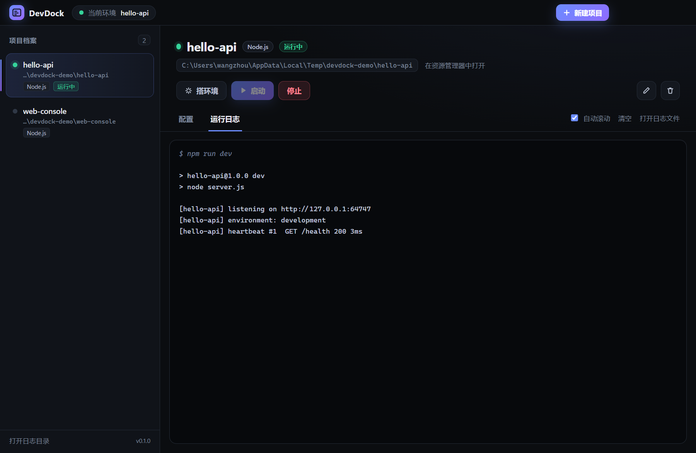

<div align="center">
  
  <h1>DevDock</h1>
  <p><strong>Windows 本地项目启动器</strong><br />录入一次路径与命令，之后一键搭环境、一键启动，切换项目自动清理旧环境。</p>
  <p>
    
    
    
  </p>
</div>

---

<div align="center">
  
</div>

## 它解决什么问题

你有十几个本地仓库。每次开工都要回忆：这个项目用 pnpm 还是 npm？先跑 migrate 还是先起 docker？`.env` 要填哪几个变量？开三个终端窗口切来切去，关掉之后进程还赖在后台。

DevDock 把这些知识变成**项目档案**：

- 选一次目录，自动识别项目类型和常用命令
- 点「搭环境」执行安装，点「启动」跑起来，日志实时滚动
- 同一时间只有一个**活跃环境**，切到下一个项目时自动停掉旧进程、还原被改写的 `.env`
- 关掉应用再打开，上次的项目和环境状态还在

## 功能

| | |
| --- | --- |
| **项目档案** | 名称、路径、Shell、安装/启动/停止命令、环境变量，全部本地持久化 |
| **自动检测** | Node（npm/pnpm/yarn/bun）、Python（pip/poetry/uv/pipenv）、Rust、Go、.NET、Docker Compose、Ruby、Java、PHP |
| **一键搭环境** | 执行安装命令，输出实时推送到终端面板并落盘 |
| **一键启动/停止** | 通过 `taskkill /T /F` 结束整棵进程树，不留孤儿进程 |
| **环境隔离** | 子进程级注入环境变量；可选把变量写进项目 `.env`，停止或切换时自动还原 |
| **活跃环境唯一** | 切换项目时停旧进程、还原旧 `.env`、写切换记录 |
| **日志** | 终端风格实时输出、按项目分文件保存、一键定位日志文件 |

## 快速开始

### 方式一：下载安装包

到 [Releases](../../releases) 下载最新的 `DevDock-Setup-x.y.z.exe`（安装版）或 `DevDock-x.y.z.exe`（免安装版）。

> Windows 可能会对未签名程序弹出 SmartScreen 提示，点「更多信息 → 仍要运行」即可。

### 方式二：从源码运行

```powershell
git clone <你的仓库地址>
cd devdock
npm install
npm start
```

需要 Node.js 20+（开发时使用 Node 24）。

## 使用

1. 点右上角 **新建项目**，选择项目目录。
2. DevDock 会自动填好安装与启动命令；不对就手动改。
3. 需要的话展开**环境变量**，按 `KEY` / `value` 逐行添加。
4. 保存后该项目自动成为**当前环境**。
5. 点 **搭环境** 安装依赖（首次启动时若开启自动搭建也会先跑一次）。
6. 点 **启动**，切到「运行日志」看输出；点 **停止** 结束进程树。

### 环境变量与 `.env`

- 默认只注入到 DevDock 启动的子进程，不污染系统，也不改你的文件。
- 如果你的框架只认 `.env`（Vite、Next.js、Django 等），打开 **把环境变量同步写入项目 .env**。
  - 首次写入前会把原文件备份为 `.env.devdock.bak`
  - 停止、切换项目、退出应用时自动还原
  - 原文件不存在则还原时一并删除

### 环境是怎么隔离的

```
活跃项目 A ──启动──> 子进程树 A（注入 A 的变量）
                         │
                    切换到 B
                         │
                         ├─ taskkill /T /F 结束 A 的整棵进程树
                         ├─ 还原 A 的 .env（如果开启同步）
                         └─ 活跃环境 = B
```

同一时间只有一个活跃环境。查看其他项目的档案不会触发切换，只有点「启动 / 搭环境 / 设为当前环境」或新建项目才会切换。

## 数据与日志

| 内容 | 位置 |
| --- | --- |
| 项目档案 | `%APPDATA%\DevDock\profiles.json` |
| 运行日志 | `%APPDATA%\DevDock\logs\<projectId>\<时间>-<类型>.log` |

档案损坏时会自动备份为 `profiles.json.corrupt-<时间戳>.json` 并以空状态启动，不会静默丢数据。

## 常见问题

**命令执行失败，提示找不到命令？**
确认该命令在系统 PATH 中。CMD 与 PowerShell 的 PATH 可能不同，可在项目设置里切换 Shell 再试。

**安装脚本被 npm 拦截了？**
首次 `npm install` 时 npm 11 会询问是否允许 `electron` 的安装脚本。允许后才能下载 Electron 二进制；否则 `npm start` 会提示找不到 Electron。可执行 `node node_modules/electron/install.js` 补装。

**停止后端口仍被占用？**
DevDock 使用 `taskkill /T /F` 结束整棵进程树，通常不会有残留。若仍占用，说明进程已脱离父进程（例如被系统服务接管），需要在任务管理器手动结束。

**可以同时开两个项目吗？**
不可以。v1 的设计是单一活跃环境，这正是避免环境串味的关键。

**支持 macOS / Linux 吗？**
v1 只保证 Windows。代码里命令构造与进程结束逻辑已隔离在 `electron/runner.js`，后续可扩展。

## 开发

```powershell
npm install          # 安装依赖
npm start            # 启动应用
npm test             # 运行单元测试（node:test）
npm run pack         # 打包免安装目录，输出到 release/
npm run dist         # 打包 NSIS 安装包 + 免安装 exe
```

项目使用原生 HTML/CSS/JS 渲染层，没有前端构建步骤，改完刷新窗口即可（开发模式下 `Ctrl+R`）。

### 发布新版本

```powershell
# 1. 更新 package.json 的 version 和 CHANGELOG.md
# 2. 提交并打 tag
git commit -am "chore: release v0.1.1"
git tag v0.1.1
git push origin main --tags
```

推送到 `v*` tag 后，GitHub Actions 会自动运行测试、打包 NSIS 安装包与免安装版，并创建 Release。

### 目录结构

```
electron/
  main.js         # 窗口、IPC、生命周期
  preload.js      # contextBridge 白名单 API
  environment.js  # 活跃环境编排：切换、启动、清理
  store.js        # 项目档案持久化（原子写入 + 损坏自愈）
  detector.js     # 项目类型探测
  dotenv.js       # .env 备份 / 合并 / 还原
  runner.js       # 命令执行、进程树结束、日志广播
renderer/
  index.html
  styles.css
  app.js
test/             # node:test 单元测试
.planning/        # 需求、规格与计划
```

## 参与贡献

欢迎提 Issue 和 PR。提交前请确保 `npm test` 通过。

## 许可证

[MIT](LICENSE)
